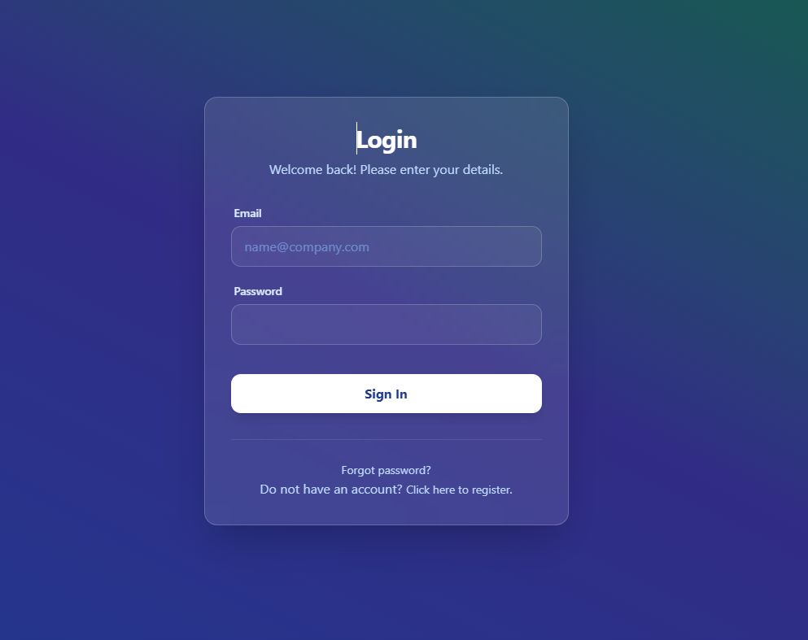
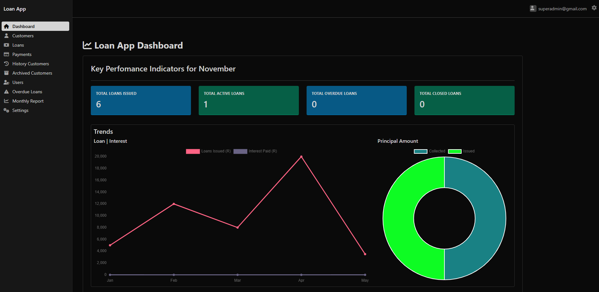
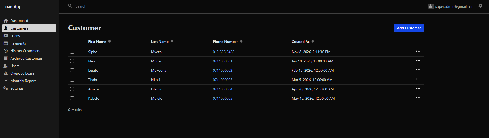
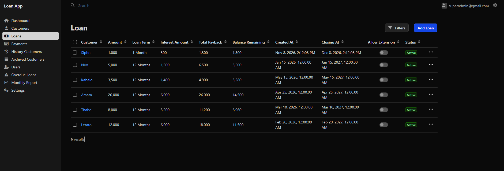
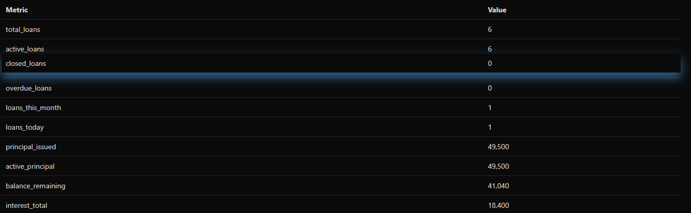

# LoanApp

A loan management system built with **Symfony** and **PostgreSQL**. Administrators manage customers, loans and repayments through an EasyAdmin dashboard.

# ✨ Attention
- This project is under developmetn, some pages are static and not using data from the database 
- such as numbers counted and calculations done for presentation
- Some front end pages are created using Ai for now to avoid having blank pages,
- as the project continues front-end pages will be replaced manually t0 showcase my front end skills
- Automatic (CRON) calculations such as the accumulation of dept is done is seconds instead of monthly
- to avoid delays during presentation phase 

## ✨ Features
- **Admin Dashboard:** Powered by EasyAdmin for managing customers and loans.
- **Role-Based Security:** Separate access for Super Admins, Admins, and Borrowers.
- **Automated Registration:** Converts new users into customer profiles automatically.
- **Docker Integration:** Pre-configured PostgreSQL 16 environment.
- **API Ready:** Custom service-based calculation endpoints.
> **Status: work in progress.** The data model and admin screens are in place. Loan calculations, a borrower area, real reports and tests are next. See the [Roadmap](#roadmap) and [Known issues](#known-issues).

## Screenshots

<!-- HOW TO ADD: save each image in docs/screenshots/ with the file name shown, then delete the "Screenshot to add" line and remove the comment markers around the image line. -->

**Login page**



**Admin dashboard**



**Customers list**



**Loan details**



**Reports page**



## What works today

- **Customers:** name, surname, phone and salary, with history notes and an archive for customers who are no longer active.
- **Loans:** amount, interest percentage, interest amount, total payback and remaining balance stored for each loan.
- **Payments:** amount paid and payment date recorded against a loan.
- **Admin dashboard (EasyAdmin 4):** create, view, edit and delete screens for customers, loans, payments, customer history, archived customers and users.
- **Accounts:** registration with email verification, and login and logout with a custom authenticator.
- **Roles:** a role hierarchy (user, admin, super admin) protecting the admin area.
- **Demo data:** fixtures that create demo admin accounts.
- **Reports:** a reports page with Chart.js.
- **Docker:** a PostgreSQL 16 database for development.

## Known issues

These are real gaps that I am fixing. I remove each item once it is done.

- [ ] The migrations only create the user tables, so the customer, loan and payment tables need `doctrine:schema:create` for now (see the setup steps).
- [ ] The dashboard menu has "Overdue Loans" and "Settings" links to pages that are not built yet.
- [ ] The monthly report shows sample numbers, not data from the database.
- [ ] The super admin role name is written two different ways (`ROLE_SUPERADMIN` and `ROLE_SUPER_ADMIN`), so the demo super admin account may not reach the admin screens.
- [ ] A loan can have only one payment record. This should allow many.
- [ ] A newly registered user has no customer profile and no borrower area yet.
- [ ] There are no automated tests.

## Roadmap

- [ ] Loan calculation service (interest, total payback, monthly instalment) with PHPUnit tests
- [ ] Repayment schedule and balance updates when a payment is recorded
- [ ] Loan status flow (applied, approved, rejected, active, settled)
- [ ] Overdue loan detection
- [ ] Reports built from real database data
- [ ] Borrower area with a customer profile created at registration
- [ ] Complete migrations
- [ ] Automated tests and a GitHub Actions workflow

## Tech stack

- PHP 8.2+, Symfony 7.3
- Doctrine ORM, Doctrine Migrations and Doctrine Fixtures
- PostgreSQL 16 (Docker Compose)
- EasyAdmin 4
- Twig and Chart.js

## Run it locally

**You need:** PHP 8.2+, Composer, Docker, and optionally the Symfony CLI.

1. Clone the repository:
   ```bash
   git clone https://github.com/NeoMudau/LoanApp.git
   cd LoanApp
   ```
2. Start the database. It runs on `localhost:5433` (database `loanshark_db`, user `loan`, password `loan1234`, development only):
   ```bash
   docker compose up -d
   ```
3. Install the dependencies:
   ```bash
   composer install
   ```
4. Create the tables. This is temporary until the migrations are complete:
   ```bash
   php bin/console doctrine:schema:create
   ```
5. Load the demo accounts:
   ```bash
   php bin/console doctrine:fixtures:load
   ```
6. Start the app:
   ```bash
   symfony serve
   # or: php -S localhost:8000 -t public
   ```
7. Open `http://localhost:8000/login`.

**Demo accounts** (development only, never use these passwords anywhere real):

| Email | Password | Role |
|---|---|---|
| `admin@gmail.com` | `admin1234` | Admin |
| `superadmin@gmail.com` | `admin1234` | Super admin (see Known issues) |

Verification emails are not sent in the default development setup.

## Tests

There are no automated tests yet. They are the next item on the roadmap.
