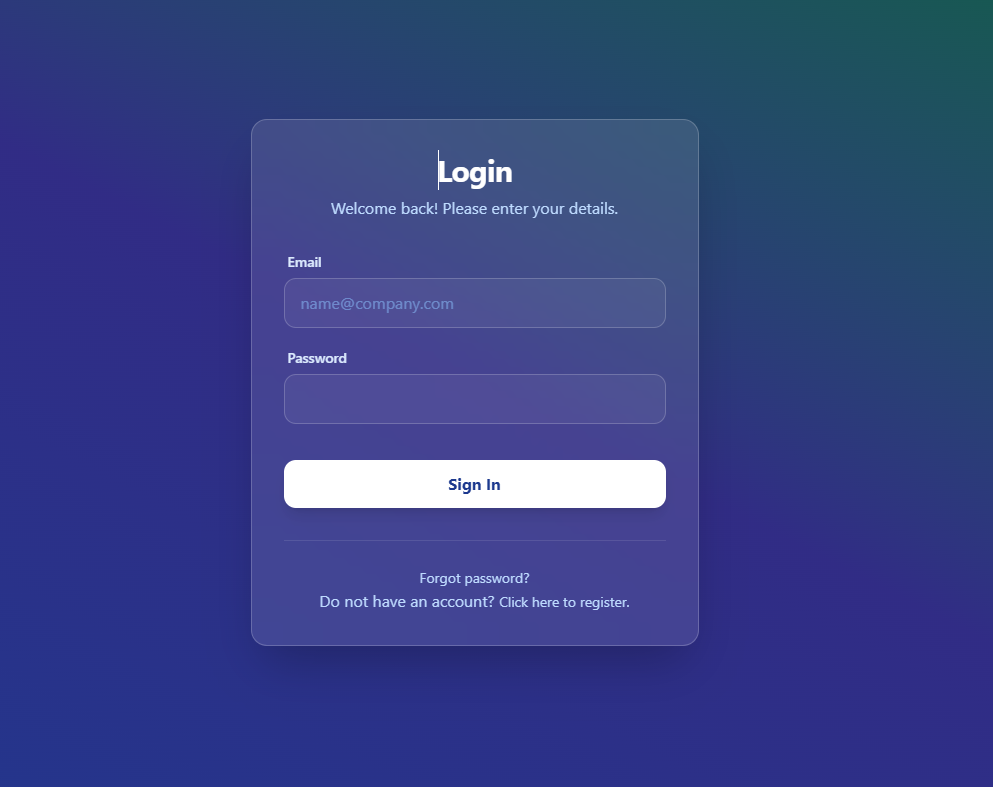
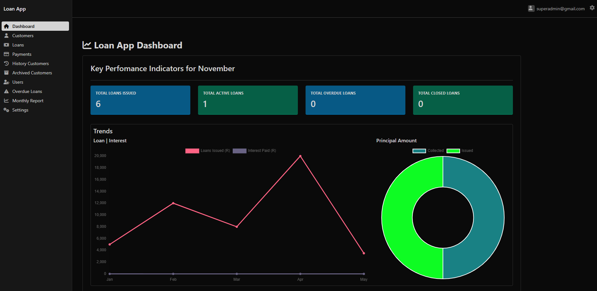
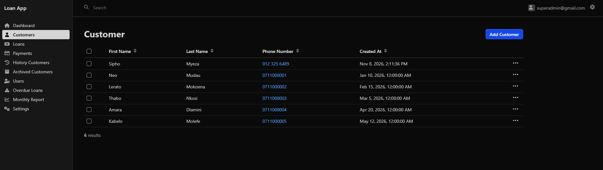
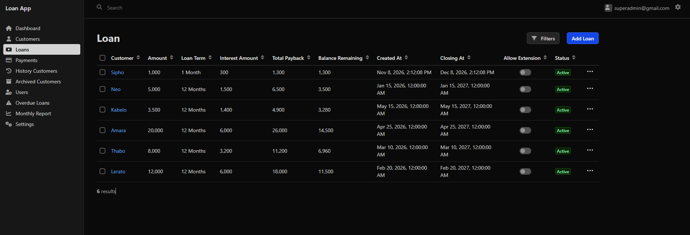
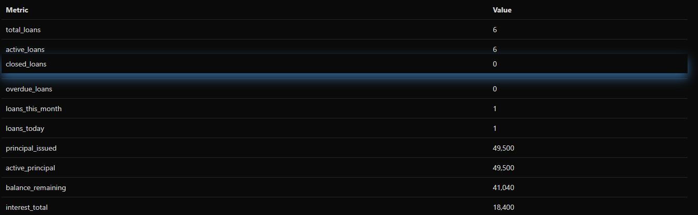

# LoanApp

A loan management system built with **Symfony** and **PostgreSQL**. Administrators manage customers, loan applications, existing loans and repayments through an EasyAdmin dashboard.

## ✨ Attention

- This project is under development. Some dashboard figures, calculations and report data are currently static or use demonstration data rather than live database records.
- Some scheduled calculations, such as debt accumulation, run at accelerated intervals during development and demonstrations instead of following their intended monthly schedule.
- Loan application processing is still being developed. The current workflow supports submitting applications, reviewing them and assessing affordability. Approval, decline and the creation of actual loans from approved applications are still to be implemented.

> **Status: Work in progress.** Customer management, loan applications and the initial application review workflow are in place. Loan processing, repayment functionality, reporting and automated tests remain under development. See the [Roadmap](#roadmap) and [Known issues](#known-issues).

## ✨ Features

- **Admin Dashboard:** Powered by EasyAdmin for managing customers, loans, payments and loan applications.
- **Customer Profiles:** Store customer information, addresses, employment details and monthly expenses.
- **Loan Applications:** Submit and manage customer loan applications separately from actual loans.
- **Affordability Assessment:** Calculate disposable income and display 30%, 40% and 50% affordability scenarios for administrative review.
- **Application Review:** Administrators can view application details and move submitted applications into review.
- **Role-Based Security:** Role hierarchy supporting users, admins and super admins.
- **Docker Integration:** Pre-configured PostgreSQL 16 development environment.

## Screenshots

<!-- HOW TO ADD: save each image in docs/screenshots/ with the file name shown, then delete the "Screenshot to add" line and remove the comment markers around the image line. -->

**Login page**



**Admin dashboard**



**Customers list**



**Loan details**



**Reports page**



## What works today

- **Customers:** Manage customer names, surnames, phone numbers and customer records.
- **Customer Information:** Store customer addresses, employment details and monthly expenses.
- **Customer History:** Record customer history notes and manage archived customers.
- **Loans:** Store existing loan information, including amounts, interest, total payback and remaining balances.
- **Payments:** Record payment information against existing loans.
- **Loan Applications:** Customers can submit loan applications containing a requested amount and repayment term.
- **Application Review:** Administrators can view submitted applications and access the customer's employment and expense information.
- **Affordability Assessment:** Calculate monthly income, total monthly expenses and disposable income. Display 30%, 40% and 50% affordability scenarios for the administrator to assess.
- **Application Status:** Administrators can move an application from `SUBMITTED` to `UNDER_REVIEW`.
- **Admin Dashboard (EasyAdmin 4):** Management screens for customers, loans, payments, customer history, archived customers, users and loan applications.
- **Accounts:** Registration with email verification, login and logout using a custom authenticator.
- **Roles:** A role hierarchy supporting users, admins and super admins.
- **Demo Data:** Fixtures for creating development demo accounts.
- **Reports:** A reports page using Chart.js. Some displayed data is still for demonstration purposes.
- **Docker:** PostgreSQL 16 database environment for development.

## Known issues

These are the current gaps being addressed.

- [ ] Verify and complete database migration coverage for all project entities and relationships.
- [ ] Complete the application approval and decline workflow.
- [ ] Create actual Loan records separately after an application has been approved.
- [ ] Complete loan calculations, including interest, total payback and monthly instalments.
- [ ] Complete repayment processing and automatic balance updates.
- [ ] Implement overdue loan detection.
- [ ] Replace demonstration figures and calculations in reports with live database data.
- [ ] Complete the borrower area.
- [ ] Add automated tests.

## Roadmap

- [x] Customer management and customer history.
- [x] Customer addresses and employment details.
- [x] Monthly expense records.
- [x] Customer profile completion checks.
- [x] Loan application submission.
- [x] Admin loan application listing and review page.
- [x] Disposable income calculation.
- [x] 30%, 40% and 50% affordability scenarios.
- [x] Move submitted applications into review.
- [ ] Application approval and decline workflow.
- [ ] Create actual loans from approved applications.
- [ ] Loan calculation service (interest, total payback and monthly instalment).
- [ ] Repayment schedule and balance updates when payments are recorded.
- [ ] Overdue loan detection.
- [ ] Reports built entirely from live database data.
- [ ] Borrower area.
- [ ] Complete database migrations.
- [ ] Automated tests and a GitHub Actions workflow.

## Tech stack

- PHP 8.2+, Symfony 7.3
- Doctrine ORM, Doctrine Migrations and Doctrine Fixtures
- PostgreSQL 16 (Docker Compose)
- EasyAdmin 4
- Twig and Chart.js

## Run it locally

**You need:** PHP 8.2+, Composer, Docker, and optionally the Symfony CLI.

1. Clone the repository:

   ```bash
   git clone https://github.com/NeoMudau/LoanApp.git
   cd LoanApp
   ```

2. Start the database. It runs on `localhost:5434` (database `loanshark_db`, user `loan`, password `loan1234`, development only):

   ```bash
   docker compose up -d
   ```

3. Install the dependencies:

   ```bash
   composer install
   ```

4. Run the database migrations:

   ```bash
   php bin/console doctrine:migrations:migrate
   ```

   **Note:** Migration coverage for the complete database schema still needs verification. Do not use `doctrine:schema:create` as a replacement for the migration workflow.

5. Load the demo data:

   ```bash
   php bin/console doctrine:fixtures:load
   ```

6. Start the application:

   ```bash
   symfony serve
   # or: php -S localhost:8000 -t public
   ```

7. Open `http://localhost:8000/login`.

**Demo accounts**

Development demo accounts are created by the fixtures. Their credentials should be checked in the fixture configuration rather than published in this README.

Verification emails are not sent in the default development setup.

## Tests

Automated tests have not yet been implemented. PHPUnit tests and a GitHub Actions workflow are planned as part of the development roadmap.